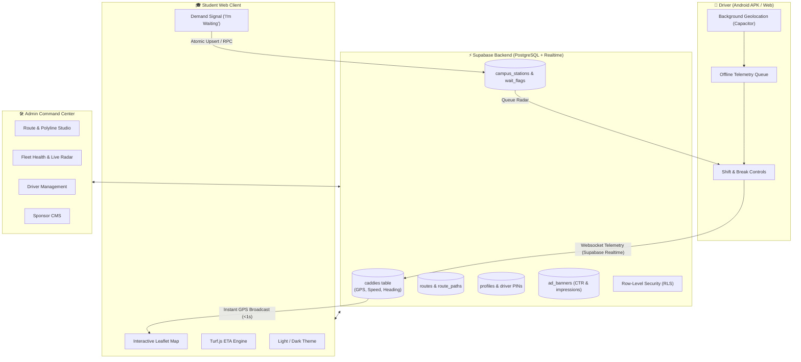

# 🚌 SNU Campus Shuttle (Caddy Hub)

> **Real-Time Intelligent Campus Transit Tracking & Fleet Management Platform**  
> Built for Shiv Nadar University (SNU) Greater Noida Campus.

[](https://nextjs.org/)
[](https://react.dev/)
[](https://www.typescriptlang.org/)
[](https://supabase.com/)
[](https://capacitorjs.com/)
[](https://tailwindcss.com/)
[](https://leafletjs.com/)
[](LICENSE)

🌐 **Live Web Application**: [https://snu-caddy.vercel.app](https://snu-caddy.vercel.app)  
📱 **Android Driver App**: Native APK powered by Capacitor & Background Geolocation

---

## 📌 Executive Summary

Navigating sprawling university campuses often leads to long wait times, overcrowded stops, and unpredictable electric shuttle ("caddy") schedules. **Campus Shuttle** is an end-to-end, sub-second GPS tracking and transit intelligence system tailored for university environments.

Without requiring expensive proprietary vehicle OBD hardware, drivers broadcast high-frequency telemetry directly through standard Android smartphones using **native background geolocation** and **battery-optimized web sockets**. Students gain instant, transparent visibility into vehicle positions, ETAs, and station congestion, while campus administrators manage fleet health and routes from a real-time command center.

---

## 🌟 Key Modules & Features

### 🎓 1. Student Portal (`/student`)
Designed for ultra-fast, low-bandwidth campus mobile and desktop browsing:
- **Interactive Live Map**: Real-time Leaflet map featuring campus building outlines, routes, and custom stations.
- **Dynamic Caddy Telemetry**: Watch shuttles glide across campus with live speed, heading, and status markers (`ON DUTY`, `ON BREAK`, `IN MAINTENANCE`, `OFF DUTY`).
- **Precision ETAs**: Algorithmic distance calculation using **Turf.js** spatial interpolation along polyline routes.
- **Passenger Demand Radar ("I'm Waiting")**: Students can flag their presence at any stop. Features a **10-minute self-expiring TTL** to avoid ghost queues and signal peak demand to drivers.
- **Multi-Route Filtering**: Filter between campus loops (e.g., Ring Road, Hostel Lines, Academic Blocks).
- **Dark & Light Mode**: Customized map tile layers and UI themes built for daytime glare and nighttime visibility.
- **Offline & Graceful Fallback**: Automatically caches the latest campus stations and geometry when cellular reception drops.

### 🚐 2. Driver Terminal & Android APK (`/driver`)
A distraction-free, high-contrast dashboard designed for shuttle drivers on the road:
- **Seamless PIN Authentication**: Fast 4-digit PIN login without requiring complex credentials.
- **Vehicle Assignment**: Pick any available caddy from the active campus fleet.
- **Background GPS Telemetry**: Integrates `@capgo/background-geolocation` and `@capacitor/geolocation` to stream accurate coordinates even when the phone is locked or screen is off.
- **WakeLock API**: Prevents driver screen dimming while on active duty.
- **Offline Ping Buffer**: If campus Wi-Fi or cellular connectivity drops, telemetry is queued in an indexed memory buffer and flushed automatically once reconnected.
- **Campus Geofencing**: Real-time bounding-box validation alerting the driver if the vehicle departs official campus grounds.
- **Passenger Queue Radar**: Live view of passenger demand counts at upcoming stations so drivers know where pickups are needed most.
- **Shift & Safety Controls**: One-tap shift status toggles (`Start Shift`, `Take Break`, `Off Duty`, `Emergency Alert`).

### 🛠️ 3. Admin Command Center (`/admin`)
Full-scale campus transit management and route planning:
- **Visual Route Studio**: Create routes, add and reorder stations, set custom route accent colors, and draw interactive polyline waypoints.
- **Fleet Supervisor**: Monitor real-time speedometer readings, GPS ping freshness, driver duty logs, and enforce remote maintenance shutdowns.
- **Zombie Shift Auto-Cleanup**: Automated backend procedures flag and release inactive driver shifts when heartbeats lapse.
- **Driver Management**: Register drivers, assign secure PINs, and review historical shifts.
- **Campus Sponsor & Ad Studio**: Publish banner ads and campus notices with real-time impressions, click-through rates (CTR), and revenue telemetry.

---

## 🏗️ Architecture & Data Flow



---

## 💻 Tech Stack

| Category | Technology | Purpose |
|---|---|---|
| **Frontend Framework** | **Next.js 16 (App Router)** | High-performance server components and client portals |
| **UI Library** | **React 19** | Modern reactive state and rendering |
| **Language** | **TypeScript 5** | Strict type safety across the full stack |
| **Styling** | **Tailwind CSS v4** | Modern design system, sleek dark glassmorphism |
| **Mapping Engine** | **Leaflet & React-Leaflet** | Lightweight, mobile-friendly interactive mapping |
| **GIS & Geocoding** | **Turf.js** | Spatial calculations, proximity radius, polyline snapping |
| **Backend & Database** | **Supabase (PostgreSQL 15)** | Realtime websocket replication, RLS, Auth, RPC functions |
| **Mobile Runtime** | **Capacitor 8** | Native cross-platform Android & iOS container |
| **Native Plugins** | `@capgo/background-geolocation` | Sustained background GPS streaming on Android |
| **Icons** | **Lucide React** | Clean, modern UI iconography |
| **Deployment** | **Vercel** | Edge network deployment & SSL auto-provisioning |

---

## 📂 Repository Structure

```text
campus-shuttle/
├── android/                         # Native Android Studio project (Capacitor)
├── public/                          # Static assets, PWA manifests, icons
├── src/
│   ├── app/
│   │   ├── admin/page.tsx           # Admin Portal entry
│   │   ├── driver/page.tsx          # Driver Terminal entry
│   │   ├── student/page.tsx         # Student Portal entry
│   │   ├── globals.css              # Global styles & Leaflet overrides
│   │   ├── layout.tsx               # Root HTML layout and viewport settings
│   │   └── page.tsx                 # Smart role-based redirector
│   ├── components/
│   │   ├── AdminMap.tsx             # Interactive route & station builder map
│   │   ├── AdminPortal.tsx          # Complete admin studio, fleet, and ads manager
│   │   ├── DriverPortal.tsx         # Driver authentication & vehicle selection
│   │   ├── DriverShift.tsx          # Active driving HUD, telemetry, background GPS
│   │   ├── StudentMap.tsx           # Student map with animated markers & routes
│   │   └── StudentPortal.tsx        # Student tracking, ETAs, and demand flags
│   ├── utils/
│   │   ├── campusData.ts            # SNU campus bounds, default stations & routes
│   │   ├── format.ts                # Date, currency (INR), and speed formatters
│   │   ├── mapConfig.ts             # Dark/Light tile layer configurations
│   │   └── supabase/                # Supabase SSR and browser client singletons
├── supabase_schema.sql              # Core database schema, tables, enums & RLS
├── telemetry_migration.sql          # High-throughput telemetry audit logs
├── fix_zombie_duty_migration.sql    # Shift cleanup and heartbeat procedures
├── capacitor.config.ts              # Capacitor mobile app configuration
└── package.json                     # Project dependencies and scripts
```

---

## 🚀 Getting Started

### Prerequisites

- **Node.js**: `v18.18+` or `v20+`
- **npm**: `v9+` (or `pnpm` / `bun`)
- **Supabase Account**: Free or Pro tier project ([supabase.com](https://supabase.com))
- *(Optional for Mobile)*: **Android Studio** for building the native APK.

### 1. Clone & Install

```bash
git clone https://github.com/PRIYANSH01-KRSN/campus-shuttle.git
cd campus-shuttle
npm install
```

### 2. Configure Environment Variables

Create a `.env.local` file in the root directory:

```env
NEXT_PUBLIC_SUPABASE_URL=https://your-project.supabase.co
NEXT_PUBLIC_SUPABASE_ANON_KEY=your-anon-key
```

*(You can copy from `.env.local.example`)*

### 3. Database Initialization

1. Open your Supabase Dashboard SQL Editor.
2. Run `supabase_schema.sql` to initialize tables, types, and security policies.
3. Apply helper migrations if needed (`fix_zombie_duty_migration.sql`, `telemetry_migration.sql`).
4. Ensure **Realtime** is enabled for the `caddies`, `campus_stations`, and `wait_flags` tables.

### 4. Run Development Server

```bash
npm run dev
```

Visit the app in your browser:
- **Student Tracker**: [http://localhost:3000/student](http://localhost:3000/student)
- **Driver Dashboard**: [http://localhost:3000/driver](http://localhost:3000/driver)
- **Admin Command Center**: [http://localhost:3000/admin](http://localhost:3000/admin)

---

## 📱 Building the Native Android APK

The project uses Capacitor to compile the Next.js web application into an installable Android APK with native background location capabilities:

```bash
# 1. Export the production web build
npm run build

# 2. Sync web assets with Capacitor Android native folder
npx cap sync android

# 3. Open in Android Studio to build APK or debug on device
npx cap open android
```

---

## 🧪 Simulation & Telemetry Testing

Want to test live tracking without driving a physical vehicle around campus? The repo includes built-in driver simulation scripts:

```bash
# Simulate a caddy smoothly driving through campus stops
node simulate_driver.js

# Test Supabase Realtime websocket subscriptions
node verify_realtime.js
```

---

## 🔒 Security & Reliability

- **Row Level Security (RLS)**: Public users can read live locations and submit demand flags, while write operations on routes, caddies, and profiles require elevated driver/admin roles.
- **Rate-Limited Demand Flags**: Prevents spamming of station queues via TTL-enforced database checks.
- **Zombie Shift Prevention**: Heartbeat checks periodically flag drivers who have been offline for >15 minutes to prevent stale ghost caddies on the map.
- **Fail-Safe Fallback**: If Supabase credentials are missing or the database is undergoing maintenance, the student portal automatically falls back to static campus geometry without crashing.

---

## 👥 Contributors & Contact

- **Author**: [Priyansh](https://github.com/PRIYANSH01-KRSN)
- **Institution**: Shiv Nadar University (SNU)

---

## 📄 License

This project is open-source under the [MIT License](LICENSE).
